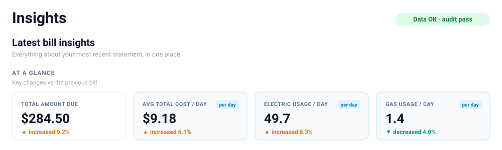
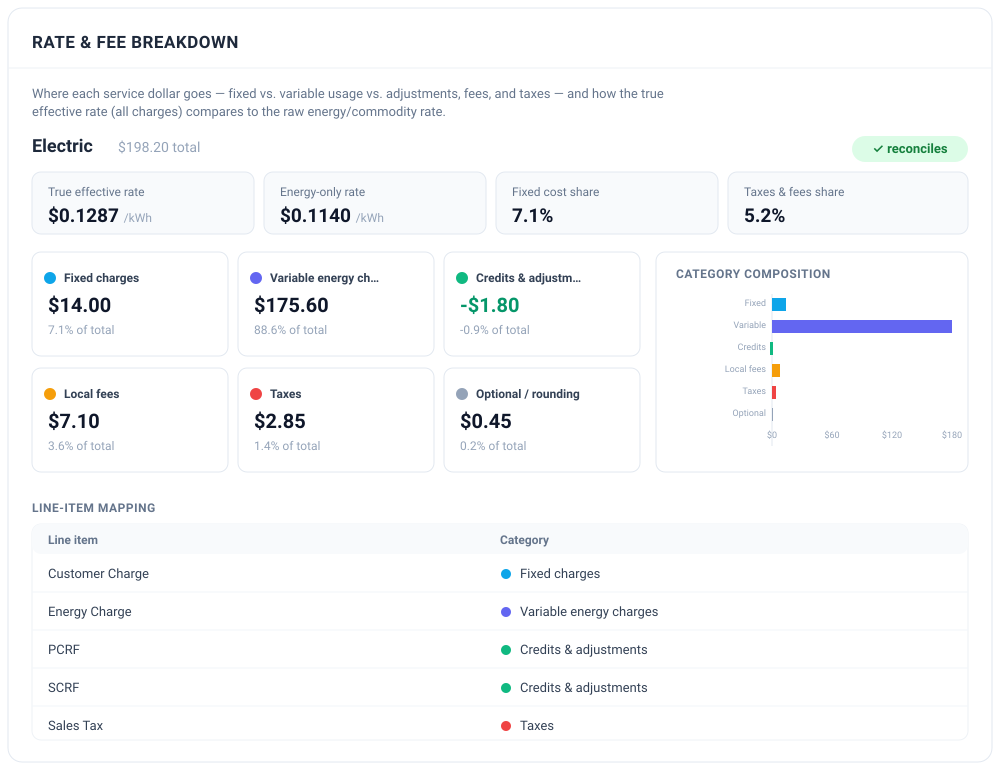
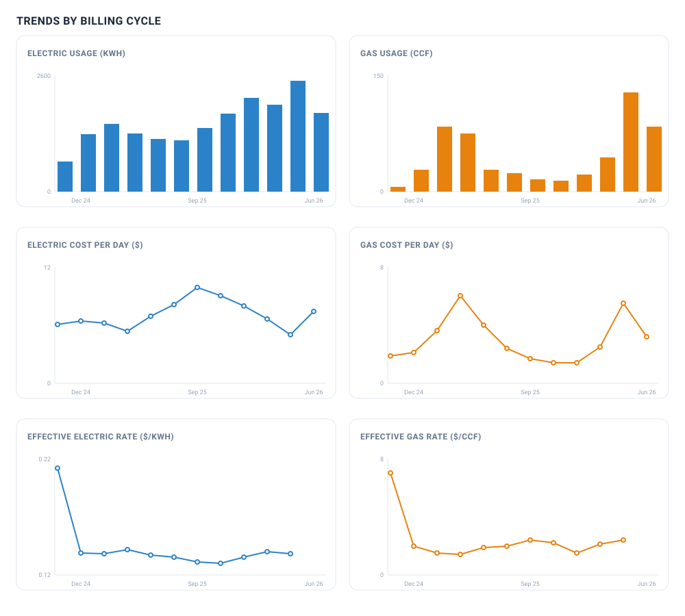
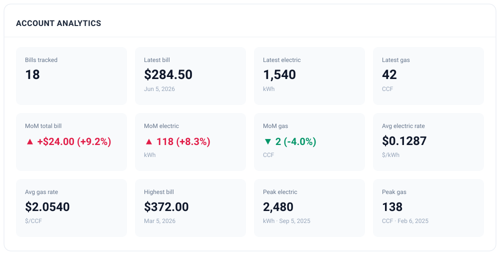

# MeterMind

**MeterMind** is a **private, local-first** web app to ingest and analyze home utility bills. It parses CoServ
electric + gas bill PDFs deterministically, stores them in a normalized database, and gives
you a dashboard plus a one-page **Insights** view: usage and cost trends, rate/fee breakdowns,
month-over-month comparisons, audits, weather-normalized usage, simple forecasts, and
deterministic "questions to investigate."

> **No LLM is used for extraction.** All canonical bill data comes from a deterministic
> `pdfplumber` + regex parser with explicit validation. An optional **local** LLM (Ollama)
> can rephrase already-parsed, redacted metrics into plain English — it never sees the PDF,
> raw text, or any personal data, and the app works fully without it.

---

## Highlights

- **Deterministic CoServ PDF parser** with confidence scoring + validation warnings.
- **Bill audit** — internal-math consistency checks (line items vs totals, meter deltas, etc.).
- **Rate & fee breakdown** — fixed vs variable vs taxes/fees/adjustments, with charts.
- **Month-over-month comparison** — normalized **per billing day** so cycle length doesn't skew it.
- **Weather context** — optional degree-day normalization (kWh per cooling degree-day, etc.).
- **Forecasting** — simple historical projection (no ML) with transparent confidence.
- **Investigation questions** — deterministic, rules-based prompts (never invented explanations).
- **Bulk upload** with deterministic duplicate detection + import history.
- **Manual corrections** — non-destructive overlay; originals preserved, audit re-run.
- **Parser versioning & reprocess** — re-run the latest parser over a stored PDF, full run history.
- **Reporting & export** — JSON / CSV / one-page PDF report (sensitive fields excluded by default).
- **Local-LLM summaries** (optional, Ollama) — secondary to the deterministic metrics.
- **Privacy & security hardening** — redaction everywhere, security headers, audit log,
  local-only privacy mode.
- **Unified Insights page** — understand the latest bill on a single screen.

---

## Screenshots

> No account numbers, names, service addresses, or meter numbers appear in any screen —
> those identifiers are redacted by design and never reach the UI.

**Unified Insights — latest bill at a glance**



**Rate & fee breakdown** (where each service dollar goes; line-item → category mapping)



**Trends by billing cycle** (usage, cost/day, and effective rate for electric & gas)



**Account analytics**



---

## Architecture

```
backend/    FastAPI + SQLAlchemy (SQLite, Postgres-ready) + pdfplumber parser  → JSON API at :8077
frontend/   Vite + React + TypeScript + Tailwind + Recharts                    → dashboard at :5173
docs/       design notes (e.g. the future SmartHub connector)
scripts/    dev.sh, dev-ollama.sh (local run helpers)
```

The Vite dev server proxies `/api` to the backend, so the browser only ever talks to `:5173`.
The backend runs on **:8077** (port 8000 is frequently already in use).

---

## Prerequisites

- **Python 3.11+** (3.12+ recommended)
- **Node.js 18+** and npm
- **Ollama** *(optional)* — only for local-LLM summaries/chat: <https://ollama.com>

---

## First-time setup

```bash
# 1. Clone, then enter the repo
git clone <your-fork-url> coserv-parser
cd coserv-parser

# 2. Backend: create a virtualenv at backend/.venv and install deps
cd backend
python3 -m venv .venv
source .venv/bin/activate
pip install -r requirements.txt
alembic upgrade head          # create the local SQLite schema
cd ..

# 3. Frontend: install deps
cd frontend
npm install
cd ..
```

The run scripts expect the virtualenv at `backend/.venv` and frontend deps installed.

---

## Running the app

### Option A — one command (recommended)

```bash
cd coserv-parser
./scripts/dev.sh
```

Starts the backend (:8077) and frontend (:5173) together and wires the proxy. Open
<http://localhost:5173>. Press **Ctrl-C** to stop both.

### Option B — with the local LLM (Ollama)

Enable the optional local-LLM panels (AI Summary / Assistant Chat) by setting `OLLAMA_ENABLED`
(env vars go **before** the command):

```bash
cd coserv-parser
OLLAMA_ENABLED=true OLLAMA_MODEL=llama3.2 ./scripts/dev.sh
```

Or use the dedicated launcher, which also makes sure the Ollama server is running and the
model is pulled:

```bash
cd coserv-parser
./scripts/dev-ollama.sh                          # default model: llama3.2
OLLAMA_MODEL=qwen2.5:7b ./scripts/dev-ollama.sh  # or pick another installed model
```

If Ollama is disabled or unreachable, the app falls back to the deterministic summary and
keeps working.

### Option C — fully offline / no outbound calls

Weather and ZIP geocoding default to live, key-less HTTP providers. To avoid **any** outbound
network calls (recommended on restricted networks, and what the test suite uses), run with the
mock providers:

```bash
cd coserv-parser
WEATHER_PROVIDER=mock GEOCODER=mock ./scripts/dev.sh
```

You can combine flags, e.g.
`WEATHER_PROVIDER=mock GEOCODER=mock OLLAMA_ENABLED=true ./scripts/dev-ollama.sh`.

### Option D — two terminals (manual)

```bash
# Terminal A — backend
cd coserv-parser/backend
source .venv/bin/activate
uvicorn app.main:app --reload --port 8077

# Terminal B — frontend
cd coserv-parser/frontend
npm run dev
```

Open <http://localhost:5173>. API docs: <http://localhost:8077/docs> · health:
<http://localhost:8077/api/health>.

> Different backend port? `HUI_BACKEND_PORT=9000 ./scripts/dev.sh`, or start uvicorn with
> `--port N` and the frontend with `VITE_API_TARGET=http://127.0.0.1:N npm run dev`.

---

## Using it

1. Open the app and go to **Upload bill** → drop a CoServ PDF (or several, via bulk upload).
2. Open **Insights** for the one-page view of the latest bill, or **Dashboard** for the full
   set of panels (corrections, rate breakdown, weather, forecast, export, privacy, etc.).

---

## Configuration (environment variables)

Core settings use the `HUI_` prefix; feature flags use their own names. All are optional.

| Variable | Default | Purpose |
|---|---|---|
| `HUI_STORAGE_DIR` | `backend/var/bills` | Where uploaded PDFs are stored |
| `HUI_DATABASE_URL` | `sqlite:///…/backend/var/home_utility.db` | Database URL (swap for `postgresql+psycopg://…` later) |
| `HUI_SECRET_KEY_FILE` | `backend/var/.secret_key` | Auto-generated secret-material file |
| `HUI_APP_SECRET` | *(falls back to key file)* | Secret used to HMAC-hash account/meter numbers |
| `HUI_CORS_ORIGINS` | `http://localhost:5173, http://127.0.0.1:5173` | Allowed frontend origins |
| `HUI_BACKEND_PORT` | `8077` | Backend port (used by the dev scripts) |
| `DEBUG_PARSER` | `false` | Verbose, **redacted** parser logging |
| `PRIVACY_MODE_LOCAL_ONLY` | `false` | Block all outbound calls + sensitive export (local Ollama still allowed) |
| `ENABLE_LOCAL_LLM` / `OLLAMA_ENABLED` | `false` | Enable optional local-LLM summaries/chat |
| `OLLAMA_MODEL` / `LLM_MODEL` | `llama3.1` | Local model tag (e.g. `llama3.2`, `qwen2.5:7b`) |
| `OLLAMA_HOST` / `OLLAMA_BASE_URL` | `http://127.0.0.1:11434` | Ollama server URL |
| `OLLAMA_TIMEOUT_SECONDS` / `LLM_TIMEOUT_SECONDS` | `60` | LLM request timeout |
| `WEATHER_PROVIDER` | `open-meteo` | `open-meteo` (live, key-less) or `mock` (offline) |
| `GEOCODER` | `zippopotam` | ZIP→lat/lon: `zippopotam` (live) or `mock` (offline) |
| `ALLOW_SENSITIVE_EXPORT` | `false` | Permit exporting account last-4 / redacted address (with `include_sensitive=true`) |
| `ENABLE_COSERV_PORTAL_CONNECTOR` | `false` | Master switch for the **future** SmartHub connector (keep off) |
| `ENABLE_BROWSER_AUTOMATION` | `false` | Permit browser automation once implemented (keep off) |
| `ALLOW_SESSION_COOKIE_STORAGE` | `false` | Permit storing encrypted session cookies (future, opt-in) |

> The LLM summary is **optional and off by default**. It only ever receives redacted,
> already-validated metrics — never the PDF, raw text, or any PII.

---

## Database & migrations

Normalized schema in `backend/app/models.py` (`users`, `utility_accounts`, `bills`,
`electric_services`, `gas_services`, `charge_line_items`, `bill_snapshots`, `parser_warnings`,
`parser_runs`, `bill_field_corrections`, `import_batches`, weather tables, and
`security_audit_events`). Money is stored as exact `Decimal` (TEXT on SQLite, `NUMERIC` on
PostgreSQL via a custom type) with explicit foreign keys.

```bash
cd backend && source .venv/bin/activate
alembic upgrade head                          # apply migrations (also the Postgres path)
alembic revision --autogenerate -m "change"   # after editing models.py
```

To move to PostgreSQL: set `HUI_DATABASE_URL=postgresql+psycopg://user:pw@host/db` and run
`alembic upgrade head` — no model changes required.

> **Tip:** stop the dev server before running migrations. The dev server auto-creates tables
> on a *fresh* DB; once a DB is migration-managed, it defers to Alembic so a reload can't race
> a pending migration.

---

## API (selected endpoints, all under `/api`)

- **Bills:** `POST /bills/upload`, `POST /bills/bulk-upload`, `GET /bills`, `GET /bills/{id}`,
  `DELETE /bills/{id}`, `POST /bills/{id}/reprocess`
- **Per-bill analysis:** `/bills/{id}/audit`, `/bills/{id}/rate-breakdown`,
  `/bills/{id}/comparison`, `/bills/{id}/weather`, `/bills/{id}/investigation-questions`,
  `/bills/{id}/summary` (+ `POST /bills/{id}/summary/regenerate`)
- **Corrections:** `GET`/`POST /bills/{id}/corrections`
- **Analytics:** `/analytics/summary`, `/analytics/insights`, `/analytics/weather-normalized`,
  `/analytics/latest-comparison`, `/insights/latest`
- **Forecast:** `/forecast/next-bill`, `/forecast?expected_billing_days=N`
- **Export:** `/export/bills.json`, `/export/{bills,electric,gas,charges}.csv`,
  `/bills/{id}/export.json`, `/bills/{id}/report.pdf`
- **Weather:** `GET`/`POST /weather/location`, `POST /bills/{id}/weather/sync`
- **Parsers:** `/parsers`, `/parsers/{provider}`, `/parsers/{provider}/latest`
- **Security/connector:** `/privacy/status`, `/security/audit-events`,
  `/connectors/coserv/status`, `POST /connectors/coserv/start-login`,
  `POST /connectors/coserv/disconnect`

Interactive docs at <http://localhost:8077/docs> when the backend is running.

---

## Tests

```bash
cd backend && source .venv/bin/activate
pytest                       # full backend suite (offline; uses mock weather/geocoder)
```

Tests synthesize CoServ-shaped PDFs and use a sanitized real-layout text fixture — **no real
bill or PII is committed**.

Frontend type-check + build:

```bash
cd frontend && npm run build
```

---

## Security & privacy

- **Sensitive values are never stored in full.** Account and meter numbers are reduced to an
  HMAC-SHA256 **hash** (for matching/dedupe) + the **last 4** digits; the service address is
  **redacted**. Hashing uses `HUI_APP_SECRET` if set, otherwise the auto-generated
  `backend/var/.secret_key`. **Keep that file safe — it is not recoverable, and losing it
  changes all future hashes.**
- **Never logged:** account numbers, names, addresses, payment barcodes, or raw PDF text.
- **Security headers** (`X-Content-Type-Options`, `X-Frame-Options: DENY`,
  `Referrer-Policy: no-referrer`, a restrictive CSP) on every response.
- **Local-only privacy mode** (`PRIVACY_MODE_LOCAL_ONLY=true`) disables all outbound calls
  (live weather, geocoding) and blocks sensitive export; the local Ollama LLM still works.
- **Audit log** of security-relevant actions (uploads, deletes, exports, corrections,
  reprocess, LLM summaries) — no sensitive values are recorded.
- **Exports are scrubbed by default**; sensitive fields require both `include_sensitive=true`
  **and** `ALLOW_SENSITIVE_EXPORT=true`.
- **No website login or browser automation.** Authenticated CoServ SmartHub ingestion is
  **designed but not implemented** — see `docs/coserv_portal_connector_design.md`. It ships as
  an inert, feature-flagged placeholder; no browser is launched and no CoServ calls are made.
- ⚠️ **Localhost-only by design.** The API has **no authentication** — it is meant to run on
  `127.0.0.1` for a single user. Both servers bind to localhost and CORS is limited to the
  local frontend. **Do not expose it to a network without putting authentication (or an
  authenticating reverse proxy) in front of it.**

---

## What's not committed (`.gitignore`)

Real bills (PII), the local SQLite DB and backups, the secret key, uploaded PDFs under
`backend/var/`, `node_modules/`, and build output are all gitignored. Only sanitized sample
material is committed.

---

## Releasing

Add a new `## [x.y.z] — Title` section at the top of `CHANGELOG.md`, commit, then:

```bash
./scripts/release.sh 0.3.0        # tags v0.3.0 + publishes a GitHub release from the changelog
./scripts/release.sh 0.3.0 --pre  # mark as a prerelease
```

The script checks you're on a clean `main`, that `gh` is authenticated, and that the top
CHANGELOG entry matches the version, then pushes `main`, tags the commit, and creates the
GitHub release with the changelog section as notes.

---

## Extending beyond CoServ

The parser and schemas are CoServ-specific by design. The parser **registry**
(`backend/app/parsers/registry.py`) and the provider-agnostic storage, hashing, API, and
dashboard scaffolding make it possible to add other providers later by registering a new
parser + schemas and tagging bills with a provider.
